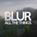

<!-- CurseForge description of Diegesis. HTML: paste it in the editor's HTML (source) mode. -->
<h1 style="text-align:center">Diegesis</h1>

<em>A library for interfaces that live on the block itself.</em>

<strong>Using a block flies the camera to it. The player then works with real 3D objects on that block: moves items, pulls levers, turns knobs, pours liquids. Everyone standing nearby sees it happen.</strong>

Diegesis adds nothing to the game on its own. Install it when a mod asks for it, such as <a href="https://www.curseforge.com/minecraft/mc-mods/hands-on-delight">Hands-On Delight</a>.

<em>The cooking pot of Hands-On Delight, built with Diegesis.</em>

<h2 style="text-align:center">🎮 For players</h2>

Put it in the mods folder next to the mod that needs it. Minecraft 1.20.1 on <a href="https://files.minecraftforge.net">Forge</a>, 1.21.1 on <a href="https://neoforged.net">NeoForge</a>, and both on <a href="https://fabricmc.net">Fabric</a> (with <a href="https://www.curseforge.com/minecraft/mc-mods/fabric-api">Fabric API</a>).

<h2 style="text-align:center">🛠️ For modders</h2>

An interface is two things. A <strong>station</strong> in Java says which blocks it opens on, what state it keeps and what the rules are. A <strong>scene</strong> in JSON says what is drawn where and what can be touched. Models come straight from <a href="https://www.blockbench.net">Blockbench</a>, and scenes reload with F3+T while the game runs.

<ul>
<li>🎥 <strong>Camera and scenes:</strong> a camera rig per scene, nodes that nest, move, turn, scale, fade and glow.</li>
<li>📦 <strong>Items on the block:</strong> clicks work as in a vanilla menu, including shift-click, splitting and dragging a stack across slots. The inventory can be a drawer or laid out in the world.</li>
<li>✋ <strong>Carried objects:</strong> held by a grip point, with weight and lean, a shadow of their own shape and triggers on touch.</li>
<li>💧 <strong>Liquids and pouring:</strong> tanks hold real volumes and mixtures that rock and ripple. The server paces and checks every pour.</li>
<li>🎛️ <strong>Ready controls:</strong> lever, rocker switch, push button, knob and slider, one line of JSON each.</li>
<li>✨ <strong>Particles, light and sound:</strong> emitters, boiling surfaces, glowing nodes that light what is near.</li>
<li>🪑 <strong>Seats and multiblocks:</strong> a station can span several blocks and seat several players, each with their own view.</li>
<li>🌐 <strong>Client-only or server:</strong> client stations work on any server. Server stations check every action, so items cannot be duplicated, and share one state between players.</li>
</ul>

📚 Guides, a cookbook and a JSON schema for scene files are on <a href="https://github.com/Pocky-l/diegesis">GitHub</a>.

<h3 style="text-align:center">Compatibility</h3>

 ✅ <a href="https://www.curseforge.com/minecraft/mc-mods/embeddium"><strong>Embeddium</strong></a> and  ✅ <a href="https://www.curseforge.com/minecraft/mc-mods/oculus"><strong>Oculus</strong></a>: scenes, liquids and particles draw as usual, with or without a shader pack

 ✅ <a href="https://modrinth.com/mod/blur-forge"><strong>Blur (Forge)</strong></a>,  ✅ <a href="https://modrinth.com/mod/reblured"><strong>ReBlured</strong></a> and  ✅ <a href="https://modrinth.com/mod/blur-plus"><strong>Blur+</strong></a>: stations stay sharp, other screens keep their blur

<!-- more-mods:start icons -->

<b>More mods by Pocky</b>

<!-- more-mods:end -->

Made by Pocky. Source on <a href="https://github.com/Pocky-l/diegesis">GitHub</a> under the MIT license.

