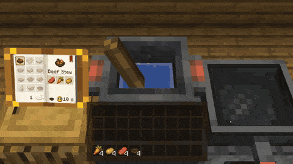

<h1 align="center">Diegesis</h1>

<p align="center">
  Library for in-world block interfaces: the camera moves to the block and players work with its 3D parts directly,
  without a GUI.
</p>

<p align="center">
  
  <a href="https://files.minecraftforge.net"></a>
  <a href="https://fabricmc.net"></a>
  
</p>

Diegesis adds nothing to the game by itself. Other mods use it to build block interfaces without menu screens. A
mod describes a **station** in Java (which blocks open it, what state it keeps, what the rules are) and a **scene** in
JSON (what is drawn where and what can be touched). Diegesis moves the camera to the block, handles the clicks and
dragging, keeps the state in sync with the server and shows it to other players.

<p align="center"></p>

## Features

- **Camera** - using a station block moves the camera to a point set in the scene. Other players see you look at the
  block.
- **Scenes from Blockbench** - nodes show Blockbench models, items or blocks. They can be nested, moved, turned,
  scaled, faded and made to glow.
- **Item slots** - clicks work as in a vanilla menu, including shift-click, double click and dragging a stack across
  slots. The inventory stays at the bottom of the screen, slides in as a drawer or is laid out in the scene.
- **Carried objects** - the player picks objects up and moves them over the block. They lag slightly behind the cursor,
  lean and cast a shadow.
- **Controls** - toggles, buttons, knobs and sliders. A lever, a switch, a button, a knob and a slider come ready to
  use with one line in a scene.
- **Liquids and pouring** - tanks hold real amounts of liquid that sway and ripple. Point a vessel at a tank to pour
  into it. The server checks every pour.
- **Particles, light and sound** - sparks, bubbles, steam, smoke and more, glowing parts that light up what is near
  them, and quiet station sounds a resource pack can replace.
- **Triggers** - a carried object reports when it touches another part of the scene, and zones react to the cursor.
- **Multiblocks and seats** - a station can cover several blocks and seat several players, each with their own view.
- **Blocks from other mods** - a station can sit on another mod's block and use that block's inventory, so hoppers keep
  working.
- **Client-only or server** - client stations work on any server. Server stations check every action and share one
  state between all players.
- **Hot reload** - F3+T reloads scene files while the game runs, and a mistyped field is reported with its name.
- **Debug view** - F3+B or `/diegesis debug` shows every hit box, node id and slot.
- **Shaders** - scenes are drawn like entities and item frames, so shader packs handle them the same way.
- **Documentation** - a guide, a cookbook, a JSON schema for scene files and a one-page API reference for coding
  assistants, with a ready skill for Claude Code.

## Quick start

Common code (both sides):

```java
public static final StationType LAB_TABLE = Diegesis.station(new ResourceLocation("mymod", "lab_table"))
        .blocks(MyBlocks.LAB_TABLE.get())
        .schema(StationSchema.builder()
                .slots("rack", 3)
                .control("gas", ControlSpec.range(0, 1, 0))
                .build())
        .logic(LabTableLogic::new)      // optional server rules: outputs, buttons, custom actions
        .register();
```

Scene, `assets/mymod/diegesis/scenes/lab_table.json` (Blockbench pixels, block facing north):

```json
{
  "camera": {"position": [8, 32, -6], "target": [8, 16, 8], "fov": 55},
  "nodes": [
    {"id": "flask", "pos": [8, 16, 9], "visual": {"model": "mymod:diegesis/flask", "translucent": true},
     "grabbable": {"lift": 3}},
    {"id": "rack_0", "pos": [3, 16, 12], "slot": {"slot": "rack[0]", "display": "upright"}},
    {"id": "gas_knob", "template": "diegesis:control/knob", "pos": [13, 16, 3], "scale": 0.6,
     "control": {"control": "gas"}}
  ]
}
```

Ready controls: `diegesis:control/lever`, `switch`, `button`, `knob` and `slider`. A node template is a node file
without an `id` in `assets/<namespace>/diegesis/nodes/`; the scene's own fields are laid over it (objects merge field
by field, `null` removes one). Your own control looks the same way: a moving `visual`, and `"base"` inside `control`
for the part that stays still, with `"pivot"` for the point a lever or knob turns round.

Interface options (all optional, defaults shown):

```json
"interface": {
  "hide_hud": true, "hide_chat": true, "hide_player": false,
  "inventory_panel": true, "show_counts": true, "counts_on_top": true, "highlight_color": "#4DFFFFFF",
  "shadows": true, "shadow_opacity": 0.5,
  "carry_lift": 2.5, "carry_stick": false, "carry_sway": 1.0, "sounds": true
}
```

Add `"carry_margin": 6` to keep carried things within 6 pixels of the block's sides (no limit by default).

The inventory can live in the scene instead of the screen panel:
`"inventory": {"pos": [8, 15.2, -5.4], "rotation": [-18, 0, 0], "spacing": 2.2, "size": 1.75, "slot_color": "#66000000"}`
(add `"surface": "<block state>"` for a board under the slots).

Client code (optional): `DiegesisClient.registerBehavior(id, MyBehavior::new)` for animations, sounds and effects that
react to the state and to what the player does.

## Documentation

- [Getting started](docs/getting-started.md) - a first station and scene.
- [Scenes](docs/scenes.md), [Stations](docs/stations.md), [Client](docs/client.md), [Cookbook](docs/cookbook.md).
- [JSON Schema](docs/schema/scene.schema.json) of scene files: add
  `"$schema": "https://raw.githubusercontent.com/Pocky-l/diegesis/main/docs/schema/scene.schema.json"` to a scene.
- [`docs/llms.txt`](docs/llms.txt) - the API on one page for AI coding assistants;
  [Claude Code skill and project notes](integrations/claude-code/README.md).

## Installation

1. Install [Forge](https://files.minecraftforge.net) or [Fabric](https://fabricmc.net) (with
   [Fabric API](https://www.curseforge.com/minecraft/mc-mods/fabric-api)) for Minecraft 1.20.1.
2. Put the jar into the `mods` folder of the client, and of the server for server stations.

## Building

```sh
./gradlew build                  # forge/build/libs and fabric/build/libs
./gradlew :forge:runGameTestServer
```

## Credits

- Author: **Pocky**.

## License

[MIT](LICENSE)
